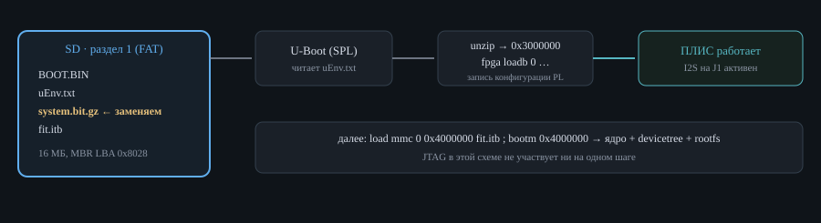

# Rebuilding the FPGA bitstream

The released SD image contains a prebuilt bitstream. Rebooting with a modified
design requires rebuilding it with Vivado and replacing one file on the card.

This guide covers the full cycle: installing the tool, obtaining the free
license, editing the project, building the bitstream, and flashing it without a
JTAG adapter.

> Written for a first-time Vivado user on Windows 10/11. Every step states what
> you should see, so a failure is caught early.

---

## 1. When a rebuild is required

| Change | Rebuild needed |
|---|---|
| Change a pin assignment in the XDC | yes |
| Add or remove a block in the block design | yes |
| Change a parameter of an existing block | yes |
| Change kernel, packages, root filesystem | no — see [build.md](../build.md) |
| Change the board's boot arguments | no — edit `uEnv.txt` |

## 2. Requirements

| Item | Value |
|---|---|
| Vivado | **2026.1** (not 2026.1.1 — see below) |
| Disk | 50 GB free before installation |
| Installed size | ~30 GB with a minimal component set |
| OS | Windows 10/11 (x86-64) |
| License | Vivado Basic tier, free, node-locked |

Since 2026.1 the free tier is delivered as a license **file** and it does **not**
cover minor updates. Install the base 2026.1 release. The license is checked at
application start, so Vivado will not open at all without it.

## 3. Installation

1. Create an account at `amd.com` — it is used both for downloads and for the
   license.
2. Download **Xilinx Unified Installer 2026.1: Windows Self Extracting Web
   Installer** (~286 MB). Do not take the full offline image (~98 GB).
3. In the installer:

| Screen | Choice |
|---|---|
| Installation Type | **Vivado** only (no Vitis, no On-Premises) |
| Install Devices | clear **All devices**, select **7 Series → Zynq-7000** |
| Cable Drivers | keep enabled — needed for JTAG |
| Install Directory | a local disk with at least 50 GB, no Cyrillic in the path |

4. Wait 40–90 minutes.

## 4. License

The Basic tier covers all 7 Series devices, including `xc7z010clg400-1`.

1. Find the Host ID — the MAC address of the active adapter (`ipconfig /all`) or
   `vlm.bat` → **View Host Information**. `vlm.bat` works without a license.
2. `account.amd.com` → **Obtain License** → **Get My Full or Purchased
   Certificate-Based License** → **Connect Now**.
3. Select **Vivado Basic Tier License** → **Node Locked License** → **Generate
   Node-Locked License**. Host: Windows, Host ID type: MAC address.
4. In `vlm.bat`: **Load License → Copy License**, choose the `.lic` file. It is
   copied to `%APPDATA%\Xilinx\`, where the tools find it.

Check: launch Vivado and run `get_parts xc7z010clg400-1` in the Tcl console. An
empty result means the device family was not installed; rerun the installer in
"Add Devices" mode.

## 5. Opening the project

The project is in `vivado_2023.2/`. Vivado 2026.1 opens it after an automatic
upgrade.

Known issue: `build_project.tcl` sets a `board_part` that is distributed only with
the vendor's own package. If that property makes project generation fail, remove
the `board_part` and `platform.board_id` lines — the part is set explicitly as
`xc7z010clg400-1`, so nothing else changes.

## 6. Editing the design

Two kinds of change are typical.

**Pin assignment.** Add a constraint block to the XDC:

```tcl
set_property PACKAGE_PIN <PIN> [get_ports <port_name>]
set_property IOSTANDARD LVCMOS33 [get_ports <port_name>]
```

**New external port.** Create the port on the block design and connect it to the
net you want to expose. Keep the original connections: the internal path (the
delta-sigma DAC on J2) must keep working.

Before choosing a pin, read section 8 of [01_audio_path.md](01_audio_path.md): a pin
that is unused in the XDC is not necessarily free on the board.

## 7. Building

In the Tcl console, or in batch mode:

```tcl
launch_runs synth_1 -jobs 4
wait_on_run synth_1
launch_runs impl_1 -to_step write_bitstream -jobs 4
wait_on_run impl_1
```

Result: `vivado_2023.2/sdr_fm_receiver.runs/impl_1/design_1_wrapper.bit`.

Checks:

| Check | Expected |
|---|---|
| File size | ~2 MB |
| First bytes | `00 09 0f f0` |
| Timing | WNS ≥ 0 in the implementation report |
| Design name | `design_1_wrapper` |

Disable incremental compilation before synthesis — the free tier does not support
it, and a stale checkpoint from an older build produces misleading results:

```tcl
set_property incremental_checkpoint "" [get_runs synth_1]
reset_run synth_1
```

## 8. Flashing without JTAG

U-Boot loads the bitstream from the FAT partition of the SD card:



*The FAT partition holds the boot loader, our `uEnv.txt`, the compressed bitstream
and the kernel; U-Boot loads the bitstream into the PL before starting Linux.*

```
uenvcmd=load mmc 0 0x2000000 system.bit.gz; unzip 0x2000000 0x3000000;
        fpga loadb 0 0x3000000 ${filesize}; load mmc 0 0x4000000 fit.itb;
        bootm 0x4000000
```

Procedure:

```sh
gzip -9 -n -c design_1_wrapper.bit > system.bit.gz
```

1. Power off the board and remove the SD card.
2. Replace `system.bit.gz` in the root of the FAT partition.
3. Return the card, power on. No JTAG adapter, no button sequence.

`gzip -9 -n` matters: without `-n` the archive stores a timestamp and the file
changes on every build, which makes checksums and diffs useless.

## 9. Flashing over JTAG (optional)

JTAG is not required for normal operation. It is useful when the board does not
boot, or for iterating without pulling the card. An RP2040 board running
`xvc-pico` works as an adapter.

Wiring between the RP2040 and the 10-pin JTAG header:

| RP2040 | JTAG signal | Header pin |
|---|---|---|
| GPIO16 | TDI | 10 |
| GPIO17 | TDO | 8 |
| GPIO18 | TCK | 6 |
| GPIO19 | TMS | 4 |
| GND | GND | 2 |

The adapter uses a libusbK driver. JTAG loading is volatile: the bitstream is
lost on power cycle.

## 10. Common problems

| Symptom | Cause | Fix |
|---|---|---|
| `Vivado cannot be launched because a valid license was not found` | license missing or bound to another MAC | load the `.lic` in `vlm.bat`; check License Diagnostics |
| Installer offers only "All devices" | the Vivado product was not selected | go back, select Vivado, expand 7 Series |
| `Board part ... is not available` | vendor board files not installed | remove `board_part` / `platform.board_id` |
| Synthesis behaves oddly, mentions `incremental` | stale checkpoint from another version | clear `incremental_checkpoint`, `reset_run synth_1` |
| `[Place 30-...]` on a pin | wrong bank voltage or I/O standard | check the package file, use `LVCMOS33` for 3.3 V banks |
| Bitstream builds, but the board does not boot | wrong file name or location | `system.bit.gz` in the FAT root, exact name |
| Board boots, but the new output is silent | port not present in the wrapper | check that the top-level wrapper exposes the port |
| `No space left on device` during build | disk full | free space; implementation needs several GB |

Logs: `vivado.log` and `vivado.jou` next to the project; run reports under
`*.runs/impl_1/`.

## 11. Where this fork expects the bitstream

The build layer of this repository picks up `bitstream/system.bit.gz` and puts it
into the FAT partition of the generated image. See [build.md](../build.md) and
`bitstream/README.md`.

---

*The design belongs to the original repository
[alexsys87/sdr_fm_receiver_zynq_7010](https://github.com/alexsys87/sdr_fm_receiver_zynq_7010).
This fork adds a packaging and build layer; the design itself is unchanged.*
