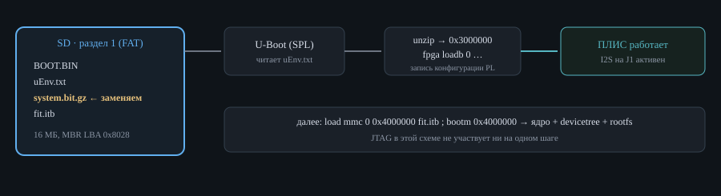

# Пересборка битстрима

Готовый образ SD-карты содержит собранный битстрим. Чтобы загрузить изменённый
дизайн, его нужно пересобрать в Vivado и заменить один файл на карте.

Документ охватывает полный цикл: установку инструмента, получение бесплатной
лицензии, правку проекта, сборку и прошивку без JTAG-адаптера.

> Написан для человека, который никогда не работал в Vivado, под Windows 10/11.
> На каждом шаге указано, что должно получиться, чтобы ошибка обнаружилась сразу.

---

## 1. Когда пересборка обязательна

| Изменение | Нужна пересборка |
|---|---|
| Изменение назначения пина в XDC | да |
| Добавление или удаление блока в block design | да |
| Изменение параметров существующего блока | да |
| Изменение ядра, пакетов, корневой файловой системы | нет — см. [BUILD.md](../BUILD.md) |
| Изменение параметров загрузки платы | нет — правится `uEnv.txt` |

## 2. Требования

| Параметр | Значение |
|---|---|
| Vivado | **2026.1** (не 2026.1.1 — см. ниже) |
| Место до установки | 50 Гб свободно |
| Место после установки | ~30 Гб при минимальном наборе компонентов |
| Операционная система | Windows 10/11 (x86-64) |
| Лицензия | Vivado Basic, бесплатная, node-locked |

С версии 2026.1 бесплатный тир выдаётся **файлом** лицензии и **не покрывает**
минорные обновления. Ставьте базовый релиз 2026.1. Лицензия проверяется при
запуске: без файла Vivado не откроется вовсе.

## 3. Установка

1. Создайте аккаунт на `amd.com` — он нужен и для загрузки, и для лицензии.
2. Скачайте **Xilinx Unified Installer 2026.1: Windows Self Extracting Web
   Installer** (~286 Мб). Полный офлайн-образ (~98 Гб) не берите.
3. В установщике:

| Экран | Выбор |
|---|---|
| Installation Type | только **Vivado** (без Vitis и On-Premises) |
| Install Devices | снять **All devices**, отметить **7 Series → Zynq-7000** |
| Cable Drivers | оставить — нужны для JTAG |
| Install Directory | локальный диск с 50 Гб, без кириллицы в пути |

4. Дождитесь окончания — 40–90 минут.

## 4. Лицензия

Тир Basic покрывает все устройства 7 Series, включая `xc7z010clg400-1`.

1. Узнайте Host ID — MAC-адрес активного адаптера (`ipconfig /all`) либо
   `vlm.bat` → **View Host Information**. `vlm.bat` работает без лицензии.
2. `account.amd.com` → **Obtain License** → **Get My Full or Purchased
   Certificate-Based License** → **Connect Now**.
3. Выберите **Vivado Basic Tier License** → **Node Locked License** → **Generate
   Node-Locked License**. Хост: Windows, тип Host ID: MAC-адрес.
4. В `vlm.bat`: **Load License → Copy License**, выберите файл `.lic`. Он
   скопируется в `%APPDATA%\Xilinx\`, откуда его находят инструменты.

Проверка: запустить Vivado и выполнить в консоли Tcl `get_parts xc7z010clg400-1`.
Пустой результат означает, что семейство устройств не установлено — запустите
установщик в режиме «Add Devices».

## 5. Открытие проекта

Проект лежит в `vivado_2023.2/`. Vivado 2026.1 откроет его после автоматического
обновления.

Известная проблема: `build_project.tcl` задаёт свойство `board_part`, которое
поставляется только с пакетом производителя платы. Если из-за него генерация
проекта завершается ошибкой, удалите строки `board_part` и `platform.board_id` — устройство
задано явно как `xc7z010clg400-1`, больше ничего не меняется.

## 6. Правка дизайна

Обычно встречаются два вида изменений.

**Назначение пина.** Добавьте в XDC блок ограничений:

```tcl
set_property PACKAGE_PIN <PIN> [get_ports <имя_порта>]
set_property IOSTANDARD LVCMOS33 [get_ports <имя_порта>]
```

**Новый внешний порт.** Создайте порт в block design и подключите его к нужной
сети. Существующие соединения сохраните: внутренний тракт (дельта-сигма ЦАП на
J2) должен продолжать работать.

Перед выбором пина прочитайте раздел 8 в [audio-path.ru.md](audio-path.ru.md):
пин, свободный в XDC, не обязательно свободен на плате.

## 7. Сборка

В консоли Tcl или в пакетном режиме:

```tcl
launch_runs synth_1 -jobs 4
wait_on_run synth_1
launch_runs impl_1 -to_step write_bitstream -jobs 4
wait_on_run impl_1
```

Результат: `vivado_2023.2/sdr_fm_receiver.runs/impl_1/design_1_wrapper.bit`.

Проверки:

| Проверка | Ожидание |
|---|---|
| Размер файла | ~2 Мб |
| Первые байты | `00 09 0f f0` |
| Тайминг | WNS ≥ 0 в отчёте имплементации |
| Имя дизайна | `design_1_wrapper` |

Перед синтезом отключите инкрементальную сборку: бесплатный тир её не
поддерживает, а устаревший чекпойнт от другой сборки даёт ложные результаты.

```tcl
set_property incremental_checkpoint "" [get_runs synth_1]
reset_run synth_1
```

## 8. Прошивка без JTAG

U-Boot загружает битстрим из FAT-раздела SD-карты:



*В FAT-разделе лежат загрузчик, наш `uEnv.txt`, сжатый битстрим и ядро; U-Boot
загружает битстрим в PL до старта Linux.*

```
uenvcmd=load mmc 0 0x2000000 system.bit.gz; unzip 0x2000000 0x3000000;
        fpga loadb 0 0x3000000 ${filesize}; load mmc 0 0x4000000 fit.itb;
        bootm 0x4000000
```

Порядок:

```sh
gzip -9 -n -c design_1_wrapper.bit > system.bit.gz
```

1. Выключить плату, вынуть карту.
2. Заменить `system.bit.gz` в корне FAT-раздела.
3. Вставить карту, включить питание. Ни JTAG, ни последовательности кнопок.

Флаг `-n` обязателен: без него в архив пишется метка времени, файл меняется при
каждой сборке, и контрольные суммы с диффами теряют смысл.

## 9. Прошивка по JTAG (необязательно)

Для обычной работы JTAG не нужен. Он полезен, когда плата не загружается или
когда нужно итерировать, не вынимая карту. В роли адаптера работает плата на
RP2040 с проектом `xvc-pico`.

Подключение RP2040 к 10-контактному разъёму JTAG:

| RP2040 | Сигнал JTAG | Пин разъёма |
|---|---|---|
| GPIO16 | TDI | 10 |
| GPIO17 | TDO | 8 |
| GPIO18 | TCK | 6 |
| GPIO19 | TMS | 4 |
| GND | GND | 2 |

Адаптеру нужен драйвер libusbK. Загрузка по JTAG летуча: после снятия питания
битстрим теряется.

## 10. Типовые проблемы

| Симптом | Причина | Решение |
|---|---|---|
| `Vivado cannot be launched because a valid license was not found` | нет лицензии или она привязана к другому MAC | загрузить `.lic` в `vlm.bat`; проверить License Diagnostics |
| Установщик предлагает только «All devices» | не выбран продукт Vivado | вернуться назад, выбрать Vivado, раскрыть 7 Series |
| `Board part ... is not available` | не установлены board files производителя | удалить `board_part` / `platform.board_id` |
| Синтез ведёт себя странно, упоминает `incremental` | устаревший чекпойнт от другой версии | очистить `incremental_checkpoint`, `reset_run synth_1` |
| `[Place 30-...]` на пине | неверное напряжение банка или стандарт ввода-вывода | сверить с файлом распиновки, для банков 3.3 В использовать `LVCMOS33` |
| Битстрим собрался, плата не грузится | не то имя или не то место файла | `system.bit.gz` в корне FAT-раздела, имя точно |
| Плата грузится, новый выход молчит | порт не попал в обёртку верхнего уровня | проверить, что wrapper содержит порт |
| `No space left on device` при сборке | мало места | освободить диск; имплементации нужно несколько Гб |

Логи: `vivado.log` и `vivado.jou` рядом с проектом; отчёты запусков — в
`*.runs/impl_1/`.

## 11. Куда этот форк берёт битстрим

Слой сборки этого репозитория забирает `bitstream/system.bit.gz` и кладёт его в
FAT-раздел собираемого образа. См. [BUILD.md](../BUILD.md) и
`bitstream/README.md`.

---

*Дизайн принадлежит исходному репозиторию
[alexsys87/sdr_fm_receiver_zynq_7010](https://github.com/alexsys87/sdr_fm_receiver_zynq_7010).
Этот форк добавляет слой упаковки и сборки; сам дизайн не изменён.*
